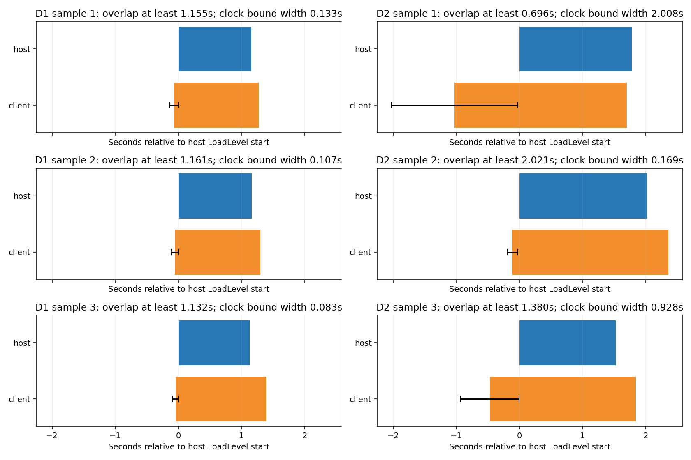

# Parallel initial LAN co-op loading

Initial host/client loading now overlaps in all six measured D1/D2 shareware
samples. The client sends a separately authenticated admission packet immediately
before LoadLevel, after mission/level/join validation. The host can fill its
roster and begin loading without waiting for the client's post-load REQUEST.
The normal post-load REQUEST, fresh authentication, SYNC and briefing barriers
remain required. No merge or cmake push was performed.

Blue is the host's local LoadLevel interval. Orange uses the midpoint of a
bounded client-to-host clock alignment; the black whisker shows how far the
whole client interval can shift. The table gives conservative overlap bounds,
not assumed clock synchronization or a synthetic sequential baseline.

| Game/sample | Host LoadLevel (s) | Client LoadLevel (s) | Overlap lower bound (s) | Clock-offset interval width (s) |
| ----------- | -----------------: | -------------------: | ----------------------: | ------------------------------: |
| D1/1        |              1.157 |                1.337 |                   1.155 |                           0.133 |
| D1/2        |              1.161 |                1.357 |                   1.161 |                           0.107 |
| D1/3        |              1.132 |                1.437 |                   1.132 |                           0.083 |
| D2/1        |              1.777 |                2.729 |                   0.696 |                           2.008 |
| D2/2        |              2.021 |                2.474 |                   2.021 |                           0.169 |
| D2/3        |              1.524 |                2.316 |                   1.380 |                           0.928 |

Values are rounded to milliseconds; CSV retains microsecond precision. D2/1
has a loose clock bound, but even its worst allowed alignment proves overlap.
The serialized control sends its first admission/request only after the client
has loaded, so host loading follows client loading. Host admission processing
in the new run reaches the StartNewLevel call within 4-32 ms of receipt.

## Matched comparison and attribution

Both runs use the same six-sample harness, fixtures, baseline probes and
original two-second request retry cadence. Faster retries are **disabled** in
this branch. These are independent CI VMs, not a paired hardware crossover.
Means below are observed wall time, with three samples per game and peer.

| Stage (seconds)                             | D1 host control to parallel | D1 client control to parallel | D2 host control to parallel | D2 client control to parallel |
| ------------------------------------------- | --------------------------: | ----------------------------: | --------------------------: | ----------------------------: |
| Auto-net entry to profiled level-init start |              5.703 to 2.442 |                2.318 to 2.021 |              5.419 to 2.768 |                2.407 to 2.122 |
| Profiled loading, including pre-load setup  |              2.137 to 1.151 |                2.166 to 1.378 |              2.534 to 1.777 |                2.172 to 2.510 |
| Native synchronization                      |              2.041 to 0.599 |                4.409 to 0.500 |              2.453 to 1.085 |                5.190 to 1.457 |
| Launch command to briefing protocol ready   |            17.151 to 10.794 |              17.141 to 10.787 |            20.372 to 14.226 |              20.355 to 14.384 |

The approximately six-second whole-startup improvement is **not an isolated
causal estimate** of parallel loading. Host loading itself was 0.99/0.76 seconds
faster in this run; native initialization and launcher preparation also varied.
The strongest result is the within-run, packet-bounded overlap above. Host
final flush-to-SYNC also fell from 2.030 to 0.595 seconds in D1 and 2.380 to
1.080 seconds in D2, despite retaining the old retry cadence. These waits now
include any unfinished client loading, so they are not pure network latency.
The matched control flushed 10 REQUESTs and 2 proofs across six host starts;
the parallel starts flushed neither. Reordering avoided the observed retry
trigger without changing the retry timer or accepting stale proofs. Therefore
the separate faster-retry gain cannot simply be added to the parallel result.

The separate retry experiment remains on investigate/lan-startup-20261020:
control39442770798 versus candidate39442351189 reduced mean host flush-to-SYNC
from 2.205 to 0.544 seconds across six samples. That is a different change;
its larger whole-startup difference is also confounded. It is not combined
with the parallel experiment or claimed as an additive measured saving.

## Correctness and failure checks

All **62 native automation receipts** passed with nonzero, fully completed
steps. All **18 peer-pair trace checks** passed: six normal samples and twelve
fault cases. Normal samples also exercise first level, exit/reactor, scores,
next briefing where present and next-level entry through the existing scripts.

| Fault case, run for both D1 and D2                             | Observed outcome                                                                                                                 |
| -------------------------------------------------------------- | -------------------------------------------------------------------------------------------------------------------------------- |
| Host held for 6 seconds before loading                         | Both peers enter level; loaded-readiness barrier retained                                                                        |
| Client held for 6 seconds, then sends another signed admission | Host ignores late admission in WAITING; accepts a distinct post-load readiness counter                                           |
| Client held for 20 seconds before loading                      | Actual holds 20.002/20.001 s; host waits 21.384/20.848 s before accepting readiness; both peers enter                            |
| Admission intentionally dropped                                | Normal post-load request restores serialized fallback; both peers enter                                                          |
| Client killed during its pre-load hold                         | No client load completion/readiness; no host readiness acceptance; host recovers with one connected player after 60.199/60.873 s |
| Fresh session after cancellation                               | Both peers enter with two connected players                                                                                      |

Early admission puts legitimate client loading inside the host's wait. Therefore
only the active launcher's initial host StartNewLevel uses a bounded **60-second
loading allowance**, measured after host loading completes. Later waits and
classic native-menu hosting retain the old 15-second timeout. This does not add
a fixed delay to successful starts. A client still absent after the allowance
is disconnected, not marked ready. Loads exceeding that allowance need another
attempt. The 20-second case crosses the formerly unsafe 15-second boundary.

Admission packet 36 has a distinct signed purpose byte; existing REQUEST
transcripts are unchanged. Retagging admission as readiness fails verification.
Admission is ignored outside initial launcher co-op selection. Observer hosts,
observers, restore, travel and in-progress joins are excluded. Existing session,
mission/version checks, proof context binding and post-load reset/flush checks
remain intact. Older hosts reject the optional unknown packet and the client
still sends its normal post-load request; dropped-admission fallback was tested,
but mixed-binary compatibility was not run explicitly.

The final observer guard additionally uses the launcher's known observer role
because Netgame.host_is_obs is finalized after selection. The final engine
revision passed a separate normal smoke: native D1, native D2 with reversed
roles, and imported D1 in D2 all had two connected peers. Timing/fault captures
precede that exclusion-only guard; the measured non-observer path is unchanged.

These are targeted checks, not exhaustive LAN coverage (the owner's generic
receipt reports coverage_complete=false). Fresh-session retry is not
same-session reconnection. Host-loss recovery, mixed versions and 3+ players
were not exercised. Native auth/policy tests cover purpose separation and gate
combinations; both D1/D2 test sets pass 3/3 and Linux net_udp objects compile.

## Measurement definitions and reproduction

- LoadLevel end is the native level_load log timestamp; start is end minus its
  recorded total_us. The startup chart reconstructs contiguous local stages from
  level_init durations and explicit launch/Activity/native/auto-net markers.
- Briefing protocol-ready is phase=6 armed=1, not the first visible frame.
  Screenshots are retained in the original artifact; no visual-feedback latency
  is inferred from them. Automation observes presenting/in_game states later.
- Admission counters match client send to host receipt. With O = host clock
  minus client clock, host SYNC-send minus client SYNC-receive bounds O below;
  host admission-receive minus client admission-send bounds O above. Each bound
  includes 2 ms of rounding allowance. Taking the minimum interval intersection
  over these bounds proves overlap without subtracting unaligned device clocks.
  This assumes a stable offset during one short launch.
- All samples restart processes and reset configs/preferences. Sample 1 clears
  app data; samples 2/3 retain assets/pilots. They are not retained-config warm
  launches. Level 2 in the same process is warm. Deliberate briefing/score dwell,
  script sleeps, fault holds and serialized 800 ms-per-peer introspection polling
  are separate from the native timing intervals.
- CI: Ubuntu 24.04; two Nexus5X_Light AVDs, API 34 Google APIs x86_64,
  1536 MiB/2 cores each, 1280x720 at 320 dpi; KVM/headless Google SwiftShader;
  emulator 37.2.12.0 build16428233; Debug APK, NDK r30, CMake 3.31.6, JDK 21.
  Device properties, emulator version and GL_RENDERER corroborate the setup.

| Purpose                    | Exact revision                           | Run                                                                                   | Artifact/export                        |
| -------------------------- | ---------------------------------------- | ------------------------------------------------------------------------------------- | -------------------------------------- |
| Matched serialized control | 964ed12b747f615e379b6e708022d7eb36a85b72 | [39442770798](https://github.com/larsonm-personal/dxx-redux/actions/runs/39442770798) | export39446278295                      |
| Parallel timing + faults   | a673dfd8e86a6315f9c557cb051340efe529c2da | [39450006075](https://github.com/larsonm-personal/dxx-redux/actions/runs/39450006075) | artifact12279926343; export39455234856 |
| Final observer-guard smoke | 7bc1593d1915be6d6986d8bd87a25d6f8910a207 | [39451088229](https://github.com/larsonm-personal/dxx-redux/actions/runs/39451088229) | artifact12279865438; export39454455784 |

The control is stacked on open/unmerged PR103 (01401425...), while cmake at experiment selection was
66e5e27da9850a9f142ac5c13d9e65432d48f4e3. This deliberately isolates
parallel loading from PR103's transition-barrier change and the separate retry
candidate. No cmake or PR103 branch was modified.
During the run, cmake advanced to 84387ccdfb5fcd761f39bd0b4f6702ad92fa8150
(PR102, Mac-asset/import changes). These pinned measurements and the stacked
PR do not include that new base; integration/performance on it remains untested.

Charts: [overlap SVG](lan_parallel_load_20261020_results/parallel/overlap.svg),
[startup timeline](lan_parallel_load_20261020_results/parallel/startup.png),
[comparison](lan_parallel_load_20261020_results/parallel/comparison.png).
Data: [overlap and fault durations](lan_parallel_load_20261020_results/parallel/overlap.csv),
[all local stages](lan_parallel_load_20261020_results/parallel/stages.csv),
[before/after means and ranges](lan_parallel_load_20261020_results/parallel/comparison.csv),
[verification](lan_parallel_load_20261020_results/parallel/verification.json),
[receipt checks](lan_parallel_load_20261020_results/parallel/checks.json).
See [reproduction commands](lan_parallel_load_20261020_results/README.md).
Source line references point to recovered excerpts; provenance files retain both
original artifact-file hashes and excerpt hashes. Bulk logs remain in CI.

Local limitations: no KVM was available, so actual execution used existing CI.
The local master-catalog self-test cannot read /proc/self/task/.../children,
even outside the command sandbox; the automation catalog passes, and CI master
selection/execution succeeded. This was not a permission denial. Initial run
39447586543 failed compilation from a missing JNI header, subsequently fixed;
39449525398 was canceled before emulator testing for the scope correction.
Export size-limit failures39453900746 and39454847121 were resolved by filtering
irrelevant diagnostics; no emulator tests were rerun for those export failures.
